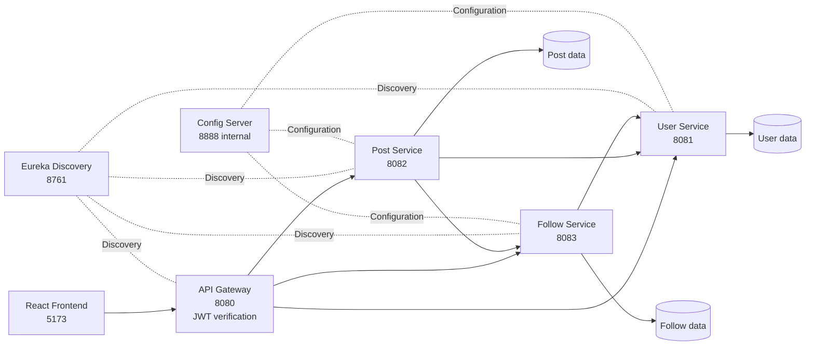

# GlobalConnect

A full-stack social networking platform built with **Java, Spring Boot microservices, React and MySQL**. Users can post, like and comment, follow other people, discover new users and browse a personalised feed.

Every request goes through an **API Gateway** that verifies a JWT and passes a trusted user identity to the services behind it. Each service owns its own database, registers with a service registry and talks to the others through resilient HTTP clients.

## Table of contents

- [Features](#features)
- [Architecture](#architecture)
- [Technology stack](#technology-stack)
- [Getting started](#getting-started)
- [API overview](#api-overview)
- [Design decisions](#design-decisions)
- [Project structure](#project-structure)
- [Roadmap](#roadmap)
- [Author](#author)

## Features

- **Authentication:** register and log in with JSON Web Tokens (JWT). The token carries the user id.
- **Moments:** create and delete posts, with a public *Recent* feed and a personalised *Following* feed.
- **Likes:** idempotent like and unlike with live counters and an optimistic UI.
- **Comments:** paginated comments. A comment can be deleted by its author or by the owner of the post.
- **Follow system:** follow and unfollow, followers and following lists, and follower statistics.
- **People discovery:** search users by username and see recently joined users.
- **Public browsing:** the Recent feed can be read without an account. Liking, commenting, following and posting ask the visitor to log in or register.
- **Resilience:** circuit breakers and fallbacks on service-to-service calls.
- **Containerised backend:** the whole backend starts with Docker Compose.

## Architecture



| Component | Port | Responsibility |
|---|---:|---|
| API Gateway | 8080 | Single entry point. Routing, JWT verification and trusted user identity. |
| User Service | 8081 | Registration, login, user lookup, batch lookup and search. |
| Post Service | 8082 | Posts, likes, comments, recent feed and personalised feed. |
| Follow Service | 8083 | Follow relationships, followers and following lists, statistics. |
| Discovery Server | 8761 | Service registration and discovery with Eureka. |
| Config Server | 8888 (internal) | Centralised configuration. |
| React Frontend | 5173 | User interface. Talks only to the gateway. |

**Request flow**

1. The React app sends a request to the API Gateway.
2. The gateway verifies the JWT, removes any `X-User-Id` header sent by the client and sets the verified one.
3. The gateway routes the request to the right service through Eureka.
4. The service reads its own database and, when needed, calls another service through a Feign client.
5. The response goes back to the frontend.

Only the gateway is meant to be reachable from outside. The business services trust the `X-User-Id` header, so they must stay inside the Docker network.

## Technology stack

| Layer | Technologies |
|---|---|
| Language | Java 21 |
| Backend | Spring Boot, Spring Security, Spring Data JPA |
| Microservices | Spring Cloud, OpenFeign |
| Gateway | Spring Cloud Gateway MVC |
| Service discovery | Netflix Eureka |
| Configuration | Spring Cloud Config |
| Resilience | Resilience4j |
| Database | MySQL (one database per service) |
| Mapping | MapStruct, Lombok |
| Frontend | React, JavaScript, Vite, React Router, Axios |
| Build tools | Maven, npm |
| Infrastructure | Docker, Docker Compose |

## Getting started

### Prerequisites

- Docker Desktop with Docker Compose
- JDK 21
- Node.js and npm
- Git

### 1. Clone the repository

```bash
git clone https://github.com/prasad2004rajana/GlobalConnect-Microservice.git
cd GlobalConnect-Microservice
```

### 2. Configure environment variables

Create a `.env` file in the project root from the template:

```powershell
Copy-Item .env.example .env
```

```bash
cp .env.example .env
```

Open `.env` and set `JWT_SECRET` to your own random string of at least 32 characters. Never commit `.env`. It is listed in `.gitignore`.

### 3. Build the backend services

The Dockerfiles copy a prebuilt jar, so build every service once before starting Docker. Run this from the repository root in PowerShell:

```powershell
$services = @(
    "api-gateway",
    "user-service",
    "post-service",
    "follow-service",
    "discovery-server",
    "config-server"
)

foreach ($service in $services) {
    Push-Location $service
    try {
        .\mvnw.cmd clean package -DskipTests
        if ($LASTEXITCODE -ne 0) {
            throw "Build failed for $service"
        }
    }
    finally {
        Pop-Location
    }
}
```

On macOS or Linux, run `./mvnw clean package -DskipTests` inside each service folder.

### 4. Start the backend

```bash
docker compose up --build -d
docker compose ps
```

Wait about a minute, then open the Eureka dashboard at http://localhost:8761. The gateway, user-service, post-service and follow-service should be registered.

To follow the logs:

```bash
docker compose logs -f
```

### 5. Start the frontend

In a second terminal:

```bash
cd frontend
npm install
npm run dev
```

Open http://localhost:5173. The frontend calls the gateway at `http://localhost:8080`.

### Troubleshooting

| Problem | What to do |
|---|---|
| Port already in use | Stop any service running from an IDE and run the backend with Docker only. |
| A service exits at start-up | Run `docker compose logs <service>` and read the first `ERROR`. If MySQL was not ready yet, run `docker compose up -d` again. |
| `ERR_CONNECTION_REFUSED` on port 8080 | The gateway is not running. Check `docker compose ps -a` and the gateway logs. |
| CORS error in the browser | The gateway allows `http://localhost:5173`. Rebuild and restart the gateway after changing the origin. |
| Maven build fails | Check that `java -version` reports 21 and read the first error in the Maven output. |

## API overview

Base URL: `http://localhost:8080`

Endpoints marked **public** need no token. All others need a valid JWT:

```http
Authorization: Bearer <your-jwt-token>
```

### Authentication and users

| Method | Endpoint | Description |
|---|---|---|
| POST | `/api/auth/register` | Register a user (public) |
| POST | `/api/auth/login` | Log in and receive a JWT (public) |
| GET | `/api/auth/users/{id}` | Get one user |
| GET | `/api/auth/users/batch?ids=1,2` | Get several users in one call (public) |
| GET | `/api/auth/users/search?q=` | Search users by username |
| GET | `/api/auth/users/recent` | Recently joined users |

### Posts, likes and comments

| Method | Endpoint | Description |
|---|---|---|
| POST | `/api/posts/create` | Create a post |
| GET | `/api/posts/recent` | Latest posts from everyone (public) |
| GET | `/api/posts/feed` | Posts from people you follow, plus your own |
| GET | `/api/posts/user/{authorId}` | Posts by one user |
| GET | `/api/posts/{postId}` | One post |
| DELETE | `/api/posts/{postId}` | Delete your own post (403 for anyone else) |
| POST / DELETE | `/api/posts/{postId}/like` | Like or unlike a post |
| GET | `/api/posts/{postId}/comments` | List comments (public) |
| POST | `/api/posts/{postId}/comments` | Add a comment |
| DELETE | `/api/posts/{postId}/comments/{commentId}` | Delete a comment (author or post owner) |

### Follows

| Method | Endpoint | Description |
|---|---|---|
| POST / DELETE | `/api/follows/{userId}` | Follow or unfollow a user |
| GET | `/api/follows/{userId}/followers` | Followers |
| GET | `/api/follows/{userId}/following` | People this user follows |
| GET | `/api/follows/{userId}/stats` | Follower and following counts, and whether you follow this user |

List endpoints accept `page` and `size` and return `{ content, page, size, totalElements, last }`.

## Design decisions

**Security**
- The gateway verifies the JWT signature and expiry, then sets `X-User-Id` from the verified `uid` claim. Any `X-User-Id` sent by a client is stripped first, which prevents header spoofing.
- Internal services trust that header, so only the gateway is exposed outside the Docker network.
- Public endpoints return only what is needed. Batch user lookup returns `id` and `username`, never the email.

**Data and consistency**
- **Database per service.** Services never read each other's tables. They call each other through Feign clients.
- **Idempotent writes.** Liking or following twice has the same effect as once. A code check is backed by a unique constraint on `(post_id, user_id)` and `(follower_id, following_id)`.
- **Atomic counters.** Like and comment counts use `UPDATE ... SET count = count + 1`, which avoids lost updates under concurrent requests. Counts never go below zero.
- **Transactions.** Inserting a row and changing the counter succeed or fail together. Deleting a post also deletes its likes and comments in the same transaction, so no orphan rows remain.

**Performance**
- **No N+1 queries.** The `likedByMe` flag for a page of posts comes from one query, and the usernames for a followers list come from one batch call to user-service.
- **Pagination everywhere**, with a maximum page size, and composite indexes on the main query columns.

**Resilience and feed**
- Feign clients use Resilience4j circuit breakers with fallbacks. If follow-service is down, the feed shows the user's own posts. If user-service is down, creating a post fails with 503 instead of risking an orphan record. A 404 is treated as a valid answer and does not trip the breaker.
- The feed uses fan-out on read: it asks follow-service for the ids you follow (capped at 1000) and then queries their posts. Fan-out on write or a cache would be the next step at larger scale.

## Project structure

```text
GlobalConnect-Microservice/
├── api-gateway/        # Routing, JWT verification, CORS
├── user-service/       # Users and authentication
├── post-service/       # Posts, likes, comments, feeds
├── follow-service/     # Follow relationships and statistics
├── discovery-server/   # Eureka service registry
├── config-server/      # Centralised configuration
├── frontend/           # React + Vite application
├── docker-compose.yml
├── .env.example
└── README.md
```

## Roadmap

- Unit and integration tests for the services
- Image uploads for posts
- Real-time chat with WebSockets
- Notifications through a message broker
- Refresh tokens and token revocation
- Database migrations with Flyway
- CI pipeline with GitHub Actions

## Author

**Prasad Rajana**

- GitHub: [prasad2004rajana](https://github.com/prasad2004rajana)
- LinkedIn: [Prasad Rajana](https://www.linkedin.com/in/prasad-rajana-85443b289)
